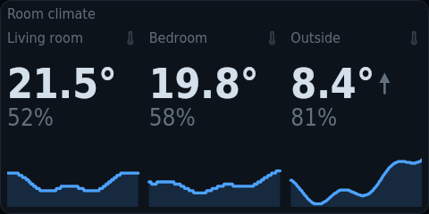
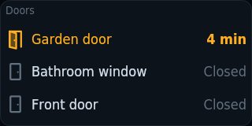
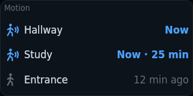

# kiosko-plugin-switchbot

Your SwitchBot thermometers, door and motion sensors on the panel, heard straight from the computer's Bluetooth: no hub, no cloud, no pairing. With a full-screen warning when a door is left open.

A plugin for [Kiosko](https://github.com/kiosko-lcd/kiosko), the widget mosaic for small USB LCD panels.



## Install

In Kiosko, **Plugins → Install from npm** → `kiosko-plugin-switchbot`, then restart Kiosko. Or from a terminal:

```sh
npm install --prefix ~/.config/kiosko/plugins kiosko-plugin-switchbot
```

(macOS: `~/Library/Application Support/Kiosko/plugins`, Windows: `%APPDATA%\Kiosko\plugins`.)

## Requirements

- Linux with BlueZ (`bluetoothd`, in every desktop distribution) and a Bluetooth adapter that does Bluetooth Low Energy (4.0 or newer), turned on; `bluetoothctl` and `busctl` (systemd 240 or newer), both already there. No pairing, hub, SwitchBot account or Home Assistant.
- The sensors within Bluetooth range of the computer (about 10–20 m indoors, less through walls). Windows and macOS: not yet.

## What it does on your machine

- **Runs**: `bluetoothctl`, `busctl`.
- **Devices**: bluetooth.

## Widgets

### Room climate — `switchbot/climate`

Temperature and humidity of each SwitchBot thermometer: big, with an arrow when it is rising or falling and a line of the last hours. One fills the tile; several share it.


Uses: `switchbot/devices`.

| Option | Type | Default | |
|---|---|---|---|
| `devices` | list | `[]` | Devices. Which to show, by name or address; !name leaves one out. Empty: all. |
| `historyMs` | duration (ms) | `43200000` | Line of the last. 0: no line. |

### Doors — `switchbot/doors`

SwitchBot contact sensors: the open doors and windows first, with how long they have been open, amber and then red when left open; a calm "All closed" when none is.



Uses: `switchbot/devices`.

| Option | Type | Default | |
|---|---|---|---|
| `devices` | list | `[]` | Devices. Which to show, by name or address; !name leaves one out. Empty: all. |
| `rows` | number | `0` | Rows. 0 = as many as fit. A number shows that many, in rows of a readable size (fewer when the tile is too small for them); the rest are counted in "+N more". |

### Motion — `switchbot/presence`

SwitchBot motion and presence sensors: where someone is moving now, and when each saw someone last.



Uses: `switchbot/devices`.

| Option | Type | Default | |
|---|---|---|---|
| `devices` | list | `[]` | Devices. Which to show, by name or address; !name leaves one out. Empty: all. |
| `rows` | number | `0` | Rows. 0 = as many as fit. A number shows that many, in rows of a readable size (fewer when the tile is too small for them); the rest are counted in "+N more". |

### SwitchBot batteries — `switchbot/batteries`

The SwitchBot sensors whose battery is running low, or a calm "Batteries OK" with the lowest one.


Uses: `switchbot/devices`.

| Option | Type | Default | |
|---|---|---|---|
| `rows` | number | `0` | Rows. 0 = as many as fit. A number shows that many, in rows of a readable size (fewer when the tile is too small for them); the rest are counted in "+N more". |

## Data sources

### SwitchBot sensors — `switchbot/devices`

SwitchBot thermometers, hygrometers, door and motion sensors, heard straight from this computer's Bluetooth: what they broadcast every few seconds, read without pairing, connecting or a hub, and without the cloud. Linux (BlueZ) for now. Read every 1 min while a widget uses it. Options are set once in Kiosko → Settings → Data sources.

| Option | Type | Default | |
|---|---|---|---|
| `devices` | list | `[]` | Devices. Which to show, by name, address or kind (climate, contact, motion, presence); !AA:BB:* leaves one out. Empty: every SwitchBot heard. |
| `names` | map | `{}` | Names. A name for each device, by its Bluetooth address (the SwitchBot app shows it under the device's settings → Device info): "C7:6B:06:06:05:55" → "Living room". |
| `openWarnMs` | duration (ms) | `0` | Highlight an open door after. It turns amber. 0: as soon as it opens. |
| `openAlertMs` | duration (ms) | `600000` | Left open after. It turns red and, if full-screen alerts are on, shows one, once each time it is left open. |
| `showAlerts` | boolean | `true` | Full-screen alert when a door is left open |
| `alertDoors` | list | `[]` | Doors that alert. Which doors may raise the full-screen alert, by name or address; !Fridge leaves one out. Empty: every door. |
| `batteryWarn` | number | `20` | Battery low at |
| `batteryAlert` | number | `10` | Battery almost empty at |
| `units` | `auto` \| `celsius` \| `fahrenheit` | `"auto"` | Temperature in |
| `staleMs` | duration (ms) | `900000` | Old after. A device not heard for this long is shown dimmed, with when it was heard last. |
| `listenMs` | duration (ms) | `10000` | Listen for. Each read scans Bluetooth this long, then rests until the next one (the source's interval, a minute by default). Shorter is gentler on Bluetooth headphones playing on the same adapter; longer hears far devices better. |
| `whileAudio` | `short` \| `pause` \| `normal` | `"short"` | While Bluetooth audio plays |

## How it listens

SwitchBot sensors broadcast their readings every few seconds to anyone
listening, the way the SwitchBot app and Home Assistant hear them. This
plugin listens too, with the computer's own Bluetooth, and never talks
back: it doesn't pair, connect, or write to any device, and never changes
the adapter (power, pairable, discoverable). If Bluetooth is off it says so
and stays off.

On Linux, through BlueZ, with programs every distribution has and no native
code:

- Each read opens a **scan window** (`listenMs`, 10 s by default) with
  `bluetoothctl --agent off` (BlueZ's own client; no pairing agent is
  registered): a Bluetooth Low Energy-only discovery (`transport le`, so no
  classic inquiry) that reports every advertisement (`duplicate-data on`).
  It is an active scan: it also gets the scan responses, where SwitchBot puts
  the device type and the battery.
- During the window it asks BlueZ what it heard every 2 s
  (`busctl --json=short … GetManagedObjects`), then stops the scan.
- Then it rests until the next read: the source's interval, **a minute** by
  default (Kiosko → Settings → Data sources). With the defaults the radio
  scans about a sixth of the time.
- **Bluetooth headphones**: scanning shares the radio with them, and on some
  adapters a long scan can make audio stutter. While BlueZ is streaming
  audio (a `MediaTransport1` is `active`) the window shrinks to 3 s, or is
  skipped (`whileAudio`: *Listen briefly*, *Don't scan*, *As usual*). If you
  still hear it, shorten `listenMs` or lengthen the interval.
- Passive listening (no scan requests at all) would be lighter, but BlueZ
  only offers it to ordinary programs through `AdvertisementMonitorManager1`,
  which needs `bluetoothd --experimental`; the plugin doesn't change system
  services, so it uses the short windows above.

Windows (WinRT's `BluetoothLEAdvertisementWatcher`) and macOS
(CoreBluetooth) readers are not written yet; the decoding and the widgets
don't depend on how the bytes are heard, so they can come later.

A sensor whose advertisement came without its scan response (too far, or a
moment of bad luck) can't say what it is: the plugin remembers the model of
each address once it has heard it, in its data folder, with the last hours
of each thermometer and when each door opened, so a restart doesn't lose
them.

## Devices

| Device | Device type | What is shown |
|---|---|---|
| Meter, Meter Plus, Indoor/Outdoor Thermo-Hygrometer, Meter Pro | `T`, `i`, `w`, `4` | Temperature, humidity, battery |
| Meter Pro CO2 | `5` | The same, and CO2 (ppm) |
| Hub 2, Hub Mini Matter, Hub 3, Weather Station | `v`, `%`, product ids | Temperature and humidity of their sensor (Hub 3: motion too) |
| Contact Sensor | `d` | Open or closed, since when, left open past the timer set in the app; battery |
| Motion Sensor | `s` | Motion now, when last; battery |
| Presence Sensor | product id `0x0010ccc8` | Someone there now, for how long, or since when no one; battery |

Other SwitchBot products are recognised by name (in the source's device
list) but not shown. An advertisement marked encrypted (bit 7 of the device
type) is said to be so and not read. Temperatures show as each
thermometer's own screen does (°C or °F), or as you choose (`units`).

## Names

Every device is known by its Bluetooth address. Give each a name in
Settings → Data sources → SwitchBot sensors → **Names**: the address (as the
SwitchBot app shows it under the device's settings → *Device info*, any
spelling) → the name, `C7:6B:06:06:05:55` → `Living room`. Until then a
widget shows the kind and the end of the address, "Thermometer 0555".

## Doors left open

Open doors go first in **Doors**, amber from `openWarnMs` (at once by
default) and red from `openAlertMs` (10 min). With **Full-screen alert when a
door is left open** on, a red door also takes every screen over once per
time it is left open: "Seen" hides it until the door is closed and left open
again. **Doors that alert** (`alertDoors`) picks which doors may; turn on
*Watch for alerts without a widget* for the source in Settings → Data
sources to be warned even with no Doors tile on screen.

## Where the decoding comes from

The byte layouts are those of [pySwitchbot](https://github.com/sblibs/pySwitchbot)
(MIT, © 2018 Daniel Høyer Iversen; the library Home Assistant's SwitchBot
integration uses), ported to TypeScript, and of SwitchBot's own
[BLE documents](https://github.com/OpenWonderLabs/SwitchBotAPI-BLE). See
[NOTICE](NOTICE). Not affiliated with SwitchBot or Woan Technology.

## Development

```sh
npm install
npm test          # node:test
npm run check     # TypeScript
npm run build     # dist/index.js, what Kiosko loads
```

To try it in a running Kiosko without publishing: `kiosko plugins link .` and restart Kiosko.

Working on Kiosko and its plugins together: clone them side by side
(`kiosko/` and `kiosko-plugins/kiosko-plugin-switchbot/`) and run `npm install` in
`kiosko/`; its workspaces link every plugin found in `../kiosko-plugins`.

## License

MIT
